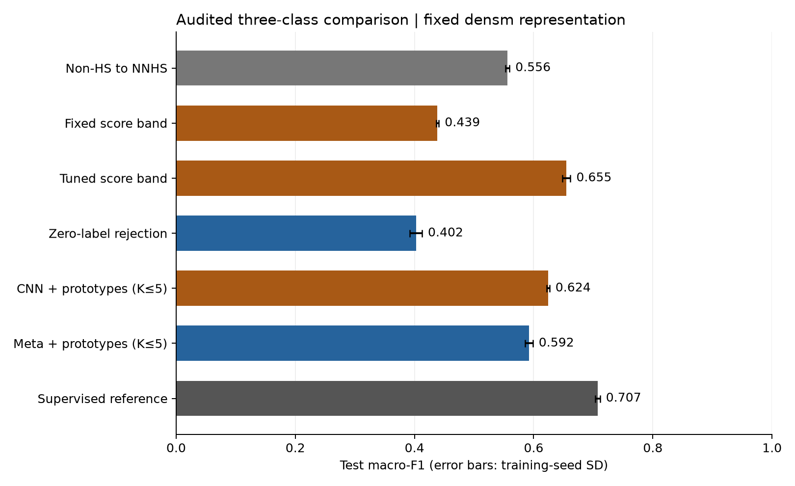
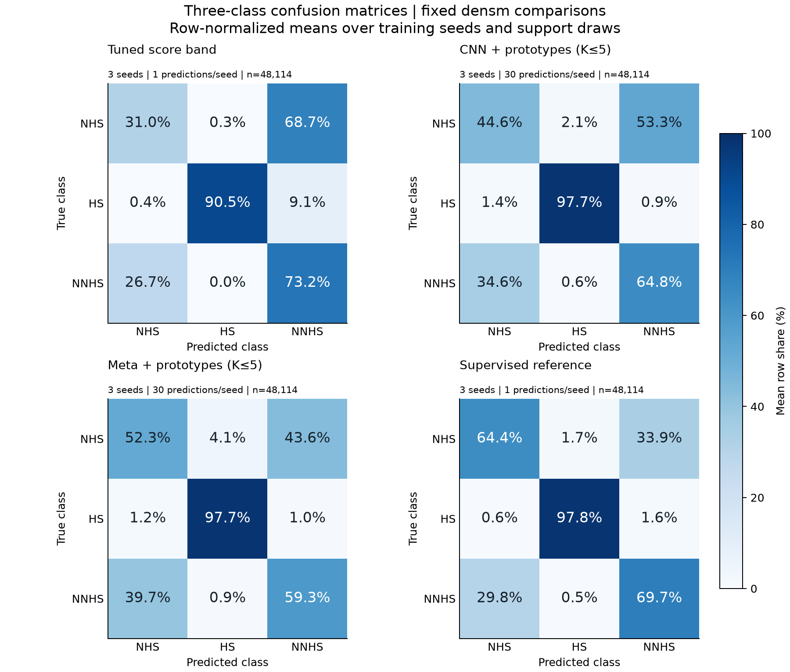
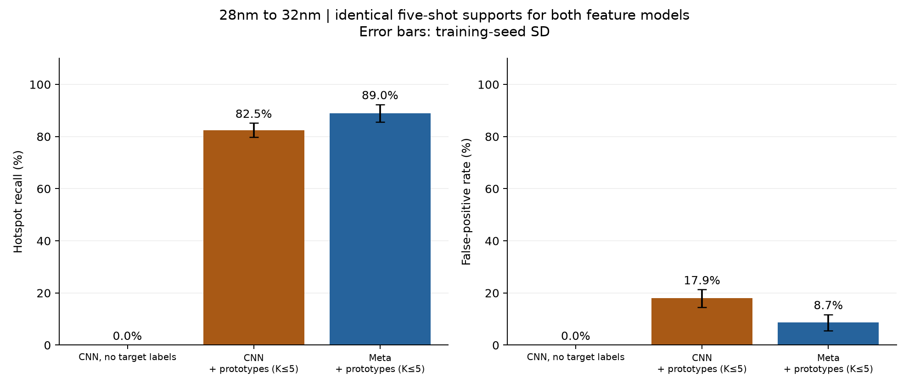
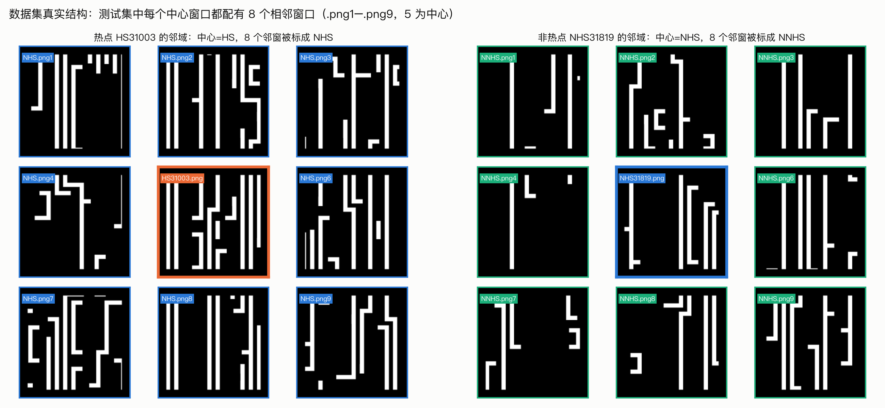
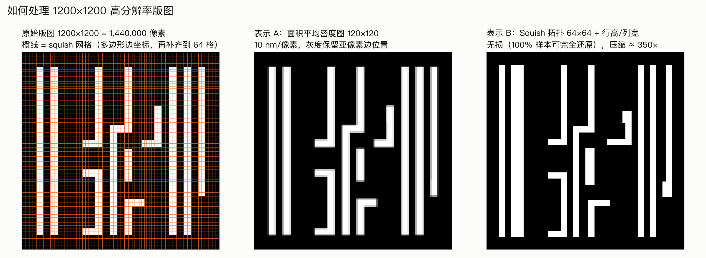

# 光刻热点检测（LithoHSD）

浙江大学《集成电路设计与制造一体化》（ISEE4091M）课程项目。输入为 1200×1200 的版图 PNG，标签为热点 HS、非热点 NHS、疑似热点 NNHS。

项目比较两种思路：HS/NHS 二分类模型加分数双阈值，以及用 HS/NHS 元训练、再提供少量三类标签的原型网络。普通 CNN 特征采用相同的支持样本和分类器作对照；全监督三分类作为经验参照。

## 当前版本：V2 审计重跑

旧版只检查完整原图的重复，遗漏了裁剪、黑边、旋转翻转及不同邻域之间的关联；旧 EVAL 也参与过方法选择。V2 固定新的划分和方法清单，全部模型从头在 `xlab01` 的 Slurm GPU 上训练。

[完整结果与图表](results/v2/RESULTS.md) · [实验协议](experiments/v2/README.md) · [预先固定的方法清单](experiments/v2/plan.json) · [数据审计](experiments/v2/audit.json) · [运行环境](experiments/v2/environment.json)

V1 数值保留在 [历史结果](results/RESULTS.md)，不能作为无泄漏泛化成绩；新旧测试集不同，不能把分数差当作算法提升。原数据已在 V1 中被探索过，V2 也不称为从未接触过的外部盲测。

## V2 结果

21 组正式训练与评估已在 xlab01 完成，模型和逐样本预测已取回；[运行记录](experiments/v2/execution.json)保存作业状态和产物核验信息。下表固定为主要 `densm` 表示，报告三个独立训练种子的均值 ± 标准差；少样本方法在每个种子内先对 30 次支持集抽样取平均。

| 三分类方法 | 额外标签预算 | TEST Macro-F1 |
|---|---:|---:|
| 双阈值（仅用 TUNE 选阈值） | 15,993 | 0.655 ± 0.007 |
| 普通 CNN 特征 + 5-shot 原型 | 75 | 0.624 ± 0.002 |
| 元学习特征 + 5-shot 原型 | 75 | 0.592 ± 0.007 |
| 全监督三分类参考 | 15,993 | 0.707 ± 0.004 |

三分类实验不支持“元学习优于普通 CNN 特征”的结论。相同的 75 个支持标签下，CNN 原型对照更好；元学习提高了 NHS 召回，但对 HS 的误报以及 NNHS/NHS 混淆使总分下降。双阈值和全监督参考用到了更多标签，不能据此声称等标签预算下优于 few-shot。

跨节点实验的方向不同：同样使用 10 个目标设计标签，元学习的 HS 召回为 **89.0%**、FPR 为 **8.7%**，CNN 原型对照分别为 **82.5%**、**17.9%**。这支持本次目标设计上的迁移收益，但目标仅含 119 张中心窗、58 个组件；完整报告给出训练种子波动和组件 bootstrap 区间，不能外推为普遍跨节点优势。

另有 `dens` 全监督单种子 Macro-F1 为 0.775。这是预先声明的表示对照，不替换 `densm` 主结果，也不足以说明不同种子下仍稳定领先。全部辅助实验和分类别指标见[完整结果](results/v2/RESULTS.md)。

## 结果展示

**三分类方法对比**（V2 TEST，误差线为训练种子标准差）：



**混淆矩阵**：HS 基本都能分对，主要错误集中在 NHS 与 NNHS 之间。



**跨工艺节点**（28nm 训练 → 32nm 测试，两种特征使用完全相同的 5-shot 支持样本）：



**数据集结构**：测试集中每个中心窗口配有 8 个相邻窗口（`.png1`–`.png9`）。热点的邻窗标为 NHS，非热点的邻窗标为 NNHS。



**高分辨率处理**：1200×1200 二值版图压成 120×120 面积平均密度图；64×64 squish 编码作为对照。



## 数据划分

把同一测试邻域、相同原图以及统一裁剪后 D4 等价的输入连成组件。组件包含官方训练图时，其中的官方测试图全部排除。剩余组件分到支持集、调参集和测试集。

| 分区 | HS | NHS | NNHS | 用途 |
|---|---:|---:|---:|---|
| TRAIN | 1,173 | 15,693 | 0 | 二分类与元训练 |
| VAL | 130 | 1,743 | 0 | 训练监控、零标签拒识阈值 |
| SUPPORT | 346 | 4,199 | 11,448 | 少样本支持；全监督参考的额外训练数据 |
| TUNE | 347 | 4,206 | 11,440 | 双阈值拟合 |
| TEST | 1,032 | 12,570 | 34,512 | 固定方法的最终评估 |
| 排除 | 1,025 | 14,528 | 50,624 | 与官方训练图所在组件相连的测试图 |

五个有效分区之间，组件、原图哈希和 masked-D4 输入键的交集均为零。共排除 66,177 张官方测试图，约 45.2%；结果仅描述这个受限子集。该检查不证明不存在任意平移、局部重叠或其他同源版图片段。

## 比较方式

- 主要表示为 `densm`：面积平均到 120×120，并将训练图统一裁剪加黑边。另以 `dens` 和无损 squish 编码作单种子对照。
- 主 few-shot 设置是每个设计、每类 5 个不同图形，共 75 个标签。CNN 和元学习模型使用相同的 30 组支持样本；三个训练种子单独重训。
- 双阈值只用 TUNE 的标签。固定区间 0.2–0.8、零 NNHS 标签拒识和非热点全判 NNHS 均单独报告。
- 全监督三分类训练使用 TRAIN + SUPPORT，不使用 TUNE/TEST。
- 跨节点任务训练时完全排除 iccad1，用每类 5 个 iccad1 训练标签适配，在 65 HS / 54 NHS 的去重中心窗口上测试。比较同标签预算的 CNN 与元学习特征，同时报告 HS 召回率、误报和 AUC。
- CNN/元学习特征维度及训练预算不同，这是完整训练方案对照，不是只改变某个损失函数的单因素实验。

## 复现

需要 Python、PyTorch、numpy、pandas、Pillow、matplotlib。训练入口要求已分配的 CUDA GPU，防止误在本机训练；协议生成、测试和评估可用 CPU。

数据不包含在仓库中，可使用课程提供的 [Google Drive 数据链接](https://drive.google.com/file/d/1In9dr5kaAXbflTDn9uUZR1yDHplWnnU4/view)。将压缩包解压到 `data/iccad-official/`，在项目根目录执行：

```bash
python code/preprocess.py data/iccad-official cache
python code/prep_masked.py data/iccad-official cache
python code/build_protocol.py
python code/test_protocol.py
python code/test_evaluate_v2.py
```

`experiments/v2/manifest.csv` 含课程数据派生路径和标签，不入 Git，可由上述步骤重建。重新生成若与已冻结文件不同会拒绝覆盖。

在本地上传 V2 代码、协议和作业脚本（数据缓存与 venv 已在集群上准备好）：

```bash
ssh xlab01 'mkdir -p ~/work/dtco/v2/{code,protocol,logs,runs,results}'
rsync -az code/ xlab01:~/work/dtco/v2/code/
rsync -az experiments/v2/manifest.csv experiments/v2/plan.json experiments/v2/audit.json xlab01:~/work/dtco/v2/protocol/
rsync -az slurm/v2.sbatch slurm/v2_evaluate.sbatch xlab01:~/work/dtco/v2/
```

集群提交命令：

```bash
ssh xlab01
cd ~/work/dtco/v2
# code/、protocol/、logs/ 已准备；上一级 cache/ 和 venv/ 为训练依赖。
sbatch v2.sbatch
# 将 JOB_ID 替换成上一步返回的作业号。
sbatch --dependency=afterok:JOB_ID v2_evaluate.sbatch
```

本地取回完成的 V2 结果：

```bash
zsh slurm/sync_v2.sh --models
```

要在本地重新评估，需要完整的 `runs/v2/` 产物（含最终模型用于哈希校验）：

```bash
python code/evaluate_v2.py
python code/report_v2.py
```

评估入口要求预声明的 21 个运行全部完成，验证划分、训练行与产物哈希，保存每次支持抽样和逐样本预测。完成标记与 checkpoint 分开，失败任务不能被误当成完成。

## 目录

```text
code/                 数据处理、V1 历史实现、V2 训练/评估与回归测试
experiments/v2/       固定方法清单、协议、审计、环境信息
slurm/               集群训练/评估作业与同步脚本
runs/v2/             新模型、预测、嵌入和训练日志
results/v2/          新指标、报告、逐样本预测与图
results/RESULTS.md    V1 历史结果及审计更正
```
