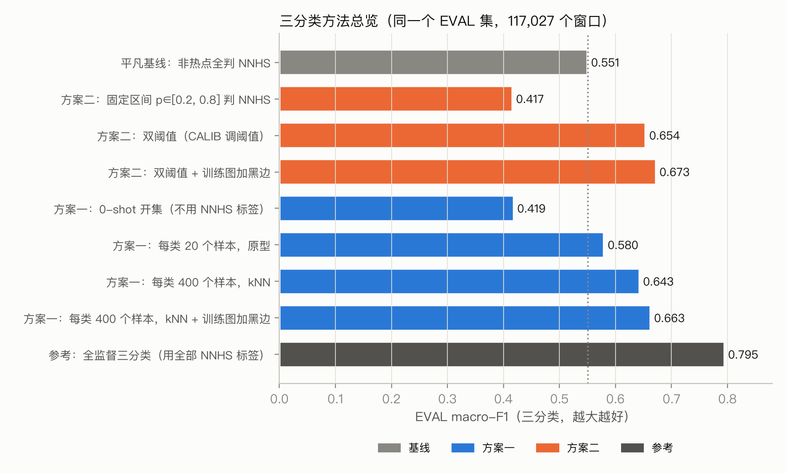
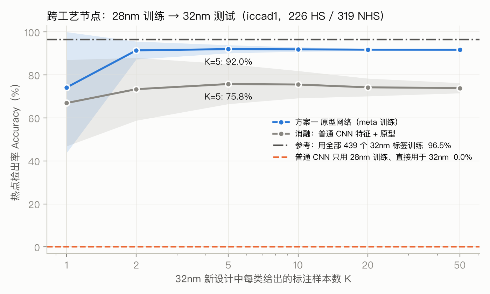
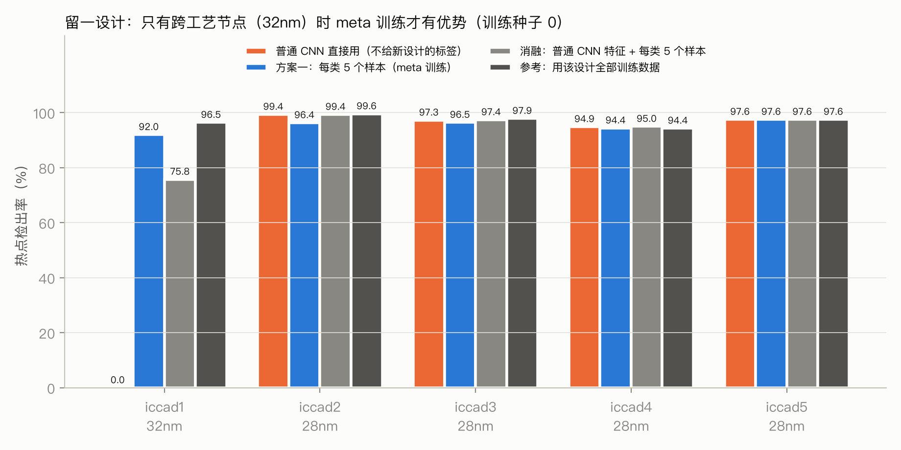
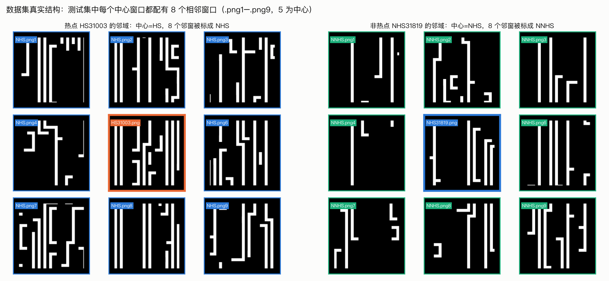
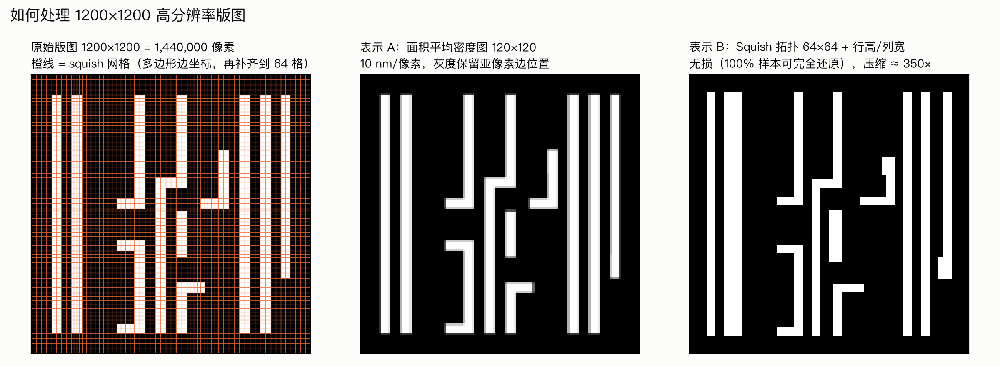

# 光刻热点检测（Lithography Hotspot Detection）

浙江大学《集成电路设计与制造一体化》（ISEE4091M）课程项目。

在 ICCAD-2012 版图数据上把 1200×1200 的版图 clip 分成三类：热点 HS、非热点 NHS、疑似热点 NNHS。难点是官方训练集里只有 HS 和 NHS，没有 NNHS。

## 方法

- **高分辨率处理**：二值版图按 10×10 像素取面积平均，压成 120×120 密度图。另做了 64×64 的无损 squish 编码作对比。
- **方案一（Meta Learning）**：原型网络（Prototypical Network）。只用 HS/NHS 做元训练，之后给少量带标签样本即可加入 NNHS 这一类，不需要重新训练。
- **方案二（概率阈值）**：HS/NHS 二分类 CNN，在校准集上搜索上下两个概率阈值，落在中间的判为 NNHS。
- **参照**：平凡基线（非热点全判 NNHS）、全监督三分类（直接用 NNHS 标签训练）。

## 主要结果

所有三分类指标都在同一个留出集 EVAL 上计算，完整表格和图见 [results/RESULTS.md](results/RESULTS.md)。

| 任务 | 结果 |
|---|---|
| 二分类（ICCAD12 标准测试集，3 个 CNN 集成） | 检出率 98.06%，误报 3 个，AUC 0.996 |
| 三分类 macro-F1：平凡基线 / 方案一 / 方案二 / 全监督参考 | 0.55 / 0.66 / 0.67 / 0.80 |
| 跨工艺节点：28nm 训练 → 32nm 测试，每类 5 个样本 | 普通 CNN 0% → 方案一 87.9%（3 个种子平均） |

数据上的几点发现：

- `.png1`–`.png9` 是中心窗口周围的 8 个相邻窗口。热点的邻窗被标为 NHS，非热点的邻窗被标为 NNHS。
- EVAL 中 11.5% 的 NNHS 与某张 NHS 图逐像素相同，仅凭图像无法区分。
- 测试图四周有 88 像素黑边，训练图没有；把训练图按测试格式渲染（`densm`）后三分类有提升。

## 结果展示

**三分类方法总览**：两个方案都超过平凡基线，但离全监督参考还有距离。



**二分类热点检测**：ICCAD12 标准测试集上的 ROC，菱形是参考论文的工作点。


**方案一的亮点：跨工艺节点**。28nm 训练的普通 CNN 在 32nm 上完全失效，方案一每类只需几个样本就能恢复大部分检出率。



**留一设计**：在 28nm 设计之间迁移时，普通 CNN 已经足够好，meta 训练没有额外优势。



**方案二为什么不够好**：NNHS 的热点概率并不落在中间，而是和真正的非热点挤在一起。


**方案一的嵌入空间**：HS 自成一簇，NHS 与 NNHS 完全混在一起。


**数据集结构与高分辨率处理**：





其余图（混淆矩阵、K-shot 曲线、阈值搜索）和全部表格见 [results/RESULTS.md](results/RESULTS.md)。

## 目录结构

```
code/       数据处理、训练、评估、作图
slurm/      Slurm 集群作业脚本
results/    RESULTS.md、metrics.json、数据审计、figures/
runs/       每次训练的日志（模型权重与预测不入库，可用脚本复现）
```

## 复现

环境：Python 3.11+、PyTorch 2.7+、numpy、pandas、pillow、matplotlib。支持 CUDA 和 Apple MPS。

数据集（ICCAD-2012 benchmark 的 PNG 版本，约 142 MB）不包含在本仓库中，可从课程提供的链接下载：
<https://drive.google.com/file/d/1In9dr5kaAXbflTDn9uUZR1yDHplWnnU4/view>

将 `iccad-official.zip` 解压到 `data/` 后：

```bash
cd code
python preprocess.py ../data/iccad-official ../cache     # 生成密度图、squish 编码、元数据
python prep_masked.py ../data/iccad-official ../cache    # 训练图按测试格式加黑边（densm）
python audit.py ../cache ../results                      # 数据审计
python train_binary.py --rep dens --seed 0               # 方案二基模型
python train_proto.py --rep dens --seed 0                # 方案一 原型网络
python train_sup3.py --rep dens --seed 0                 # 全监督三分类参考
python train_binary.py --rep dens --seed 0 --holdout iccad1   # 跨工艺节点实验
python train_proto.py --rep dens --seed 0 --holdout iccad1
python fig_explain.py && python evaluate.py && python make_report.py
```

完整实验列表见 `slurm/train_all.sbatch` 和 `slurm/seeds.sbatch`。
