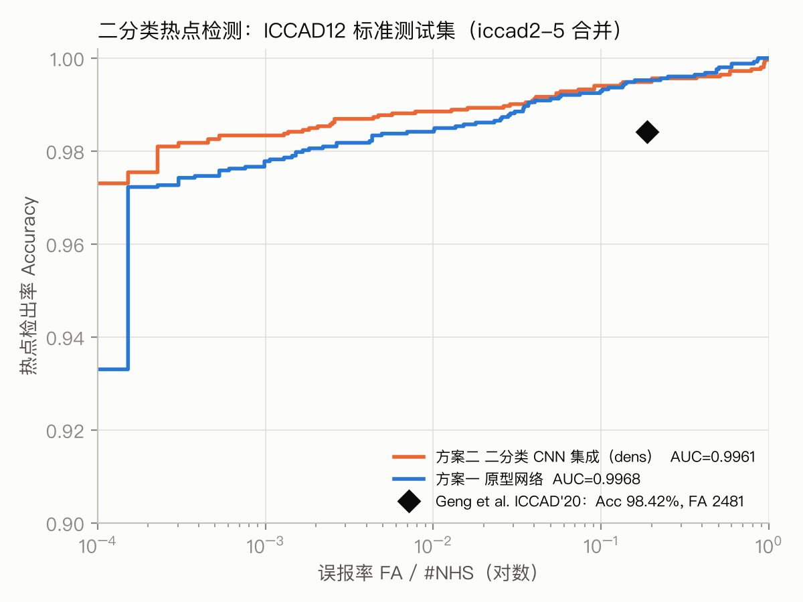
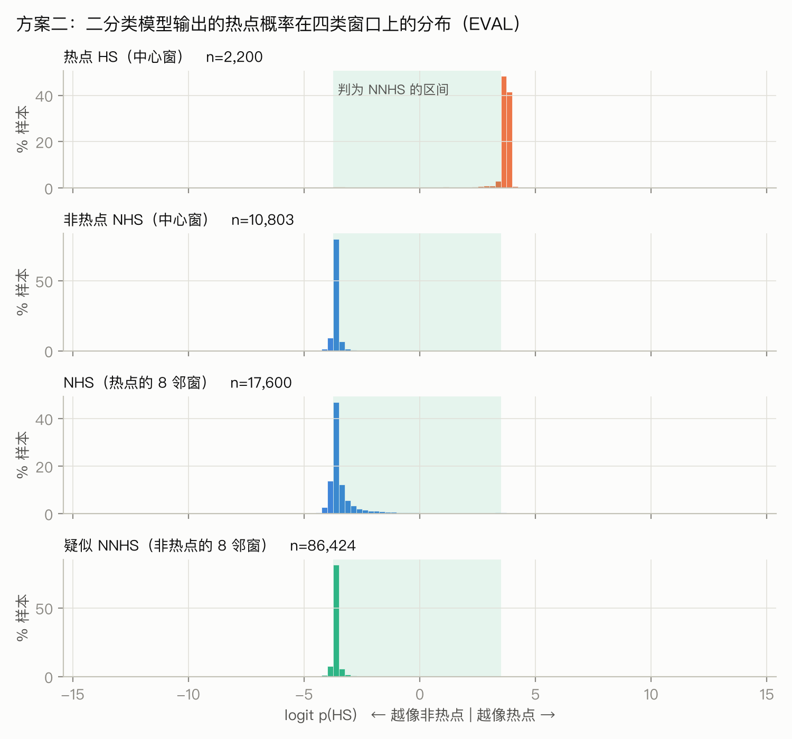
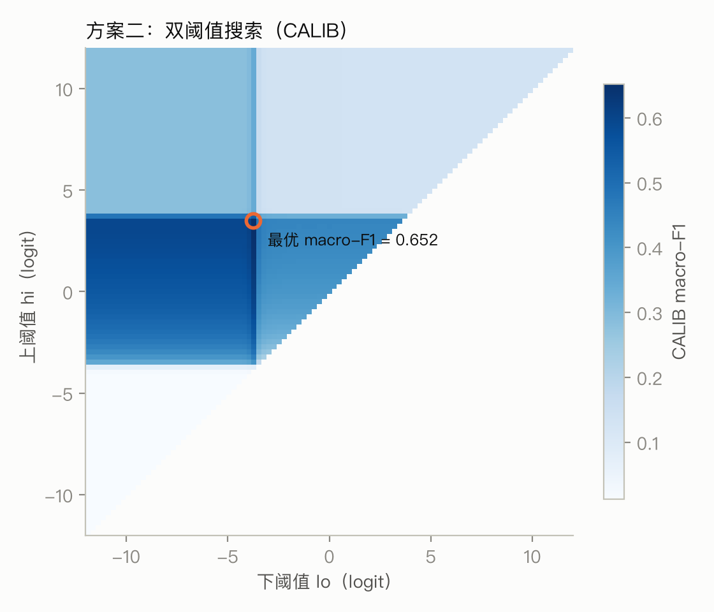
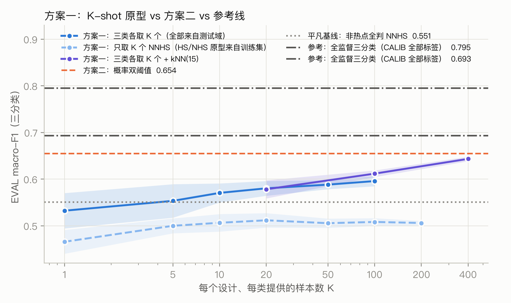
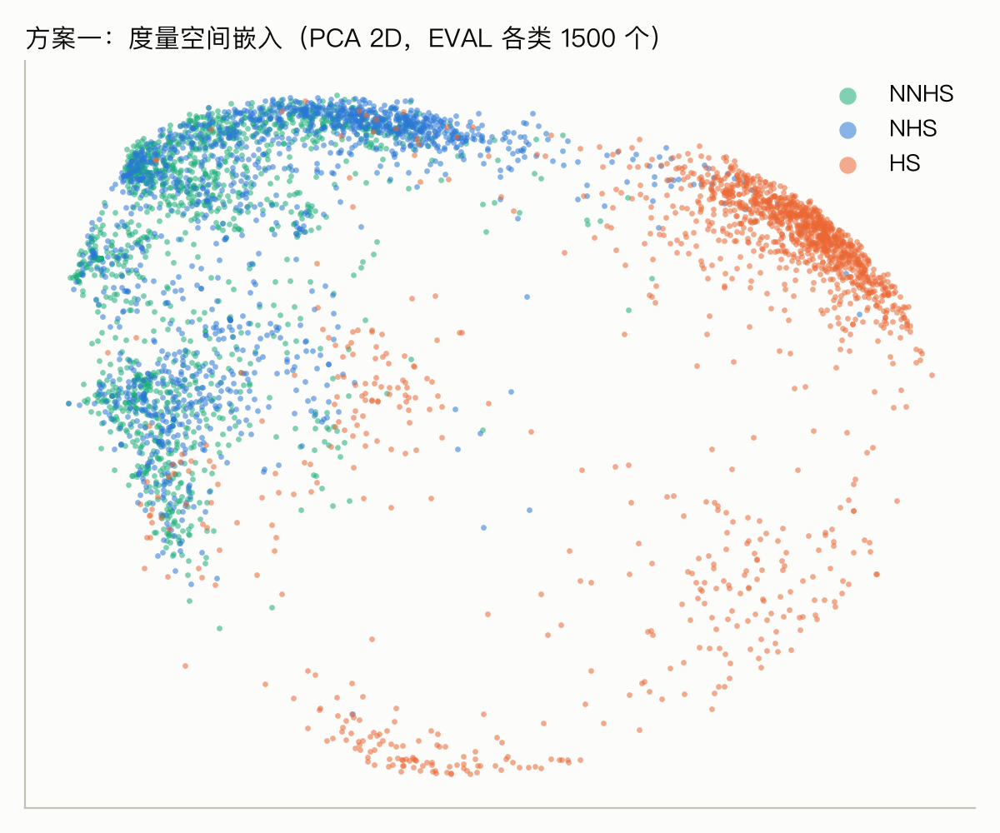
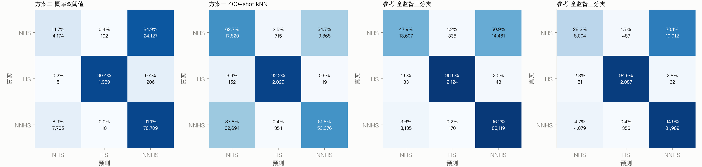

# 光刻热点检测：方案一（Meta Learning）与方案二（概率阈值）实验结果

> 本文件由 `code/make_report.py` 根据 `results/metrics.json` 自动生成。图在 `results/figures/`。

## 1. 数据划分（报告里要写清楚）

| 部分 | 来源 | HS | NHS | NNHS | 用途 |
|---|---|---:|---:|---:|---|
| TRAIN | 官方 train 的 90% | 1,172 | 15,693 | 0 | 训练 |
| VAL | 官方 train 的 10%（按设计×类别分层） | 131 | 1,743 | 0 | 监控训练、0-shot 阈值 |
| CALIB | 官方 test 的 20%（**按邻域组**划分） | 550 | 7,100 | 21,600 | 方案二调阈值 / 方案一取 K 个 NNHS 样本 / 全监督参考的训练 |
| EVAL | 官方 test 的 80% | 2,200 | 28,403 | 86,424 | **所有三分类指标都在这里报告** |

一个“邻域组”= 1 个中心窗口 + 它的 8 个相邻窗口，同组样本不会同时出现在 CALIB 和 EVAL。

## 2. 二分类热点检测（与参考论文对比）

测试集 = ICCAD12 标准测试集（iccad2–5 合并，2,524 HS / 13,184 NHS），与 Geng et al. ICCAD'20 Table 2 的样本数一致。
Accuracy = 热点检出率，FA = 被误报为热点的非热点个数。@0.5 列是固定阈值的真实结果；最后一列把阈值调到和论文相同的检出率再数误报，属于工作点对比（相当于在 ROC 曲线上取同一点），阈值用到了测试标签。

| 方法 | AUC | Accuracy@0.5 | FA@0.5 | 在论文同等 Accuracy 下的 FA |
|---|---:|---:|---:|---:|
| Geng et al. ICCAD'20（参考论文） | – | 98.42% | 2481 | 2481 |
| 方案二 CNN ensemble_dens(x3) | 0.9961 | 98.06% | 3 | 22（Acc 98.45%） |
| 方案二 CNN ensemble_densm(x2) | 0.9955 | 97.66% | 5 | 15（Acc 98.45%） |
| 方案二 CNN ensemble_squish(x1) | 0.9933 | 96.67% | 182 | 754（Acc 98.45%） |
| 方案一 原型网络 proto_dens_s0 | 0.9968 | 97.46% | 7 | 133（Acc 98.45%） |
| 方案一 原型网络 proto_dens_s1 | 0.9966 | 96.99% | 1 | 60（Acc 98.45%） |
| 方案一 原型网络 proto_densm_s0 | 0.9965 | 97.90% | 4 | 51（Acc 98.45%） |
| 方案一 原型网络 proto_squish_s0 | 0.9932 | 96.43% | 258 | 656（Acc 98.45%） |

单模型明细（表示方式消融：`dens`=120×120 面积平均密度图，`squish`=64×64 无损 squish 编码）：

| 模型 | AUC | Acc@0.5 | FA@0.5 | 同等 Acc 下 FA |
|---|---:|---:|---:|---:|
| binary_dens_s0 | 0.9946 | 97.98% | 4 | 14 |
| binary_dens_s1 | 0.9949 | 98.02% | 6 | 35 |
| binary_dens_s2 | 0.9965 | 97.98% | 6 | 19 |
| binary_densm_s0 | 0.9949 | 97.70% | 6 | 11 |
| binary_densm_s1 | 0.9953 | 97.66% | 4 | 12 |
| binary_squish_s0 | 0.9933 | 96.67% | 182 | 754 |

按 benchmark（ensemble_dens(x3)，阈值 0.5）：

| benchmark | HS | NHS | Accuracy | FA |
|---|---:|---:|---:|---:|
| iccad1 | 226 | 319 | 96.90% | 0 |
| iccad2 | 498 | 4146 | 99.60% | 3 |
| iccad3 | 1808 | 3541 | 97.84% | 0 |
| iccad4 | 177 | 3386 | 96.05% | 0 |
| iccad5 | 41 | 2111 | 97.56% | 0 |

注意：论文的 ICCAD12 测试图是 3.6×3.6 µm 的大图，本课程数据是 1.2×1.2 µm 的 clip，所以这是“同一基准、同一样本数、不同 clip 格式”的对比，汇报时要说明，不要直接宣称超过论文。



## 3. 三分类总表（EVAL，macro-F1 为主指标）

| 方法 | macro-F1 | 平衡准确率 | HS 召回 | NHS 召回 | NNHS 召回 | 用到的 NNHS 标签 |
|---|---:|---:|---:|---:|---:|---|
| 方案二（dens）概率双阈值 | **0.654** | 0.654 | 90.41% | 14.70% | 91.07% | CALIB 调阈值 p∈[0.023, 0.971] 判 NNHS |
| 方案二（dens）固定区间 0.2–0.8 | **0.417** | 0.644 | 97.05% | 95.62% | 0.53% | 无 |
| 方案二（dens）+ 集成不确定度 | **0.609** | 0.639 | 90.09% | 2.58% | 98.88% | CALIB 调阈值 |
| 平凡基线（dens）：二分类 + 非热点全判 NNHS | **0.551** | 0.658 | 97.95% | 0.00% | 99.57% | 无 |
| 方案二（densm）概率双阈值 | **0.673** | 0.674 | 93.73% | 24.29% | 84.09% | CALIB 调阈值 p∈[0.023, 0.953] 判 NNHS |
| 方案二（densm）固定区间 0.2–0.8 | **0.428** | 0.647 | 96.82% | 96.97% | 0.40% | 无 |
| 方案二（densm）+ 集成不确定度 | **0.618** | 0.653 | 93.73% | 3.56% | 98.76% | CALIB 调阈值 |
| 平凡基线（densm）：二分类 + 非热点全判 NNHS | **0.567** | 0.658 | 97.73% | 0.00% | 99.70% | 无 |
| 方案二（squish）概率双阈值 | **0.590** | 0.610 | 83.91% | 10.76% | 88.21% | CALIB 调阈值 p∈[0.018, 0.963] 判 NNHS |
| 方案二（squish）固定区间 0.2–0.8 | **0.371** | 0.626 | 94.55% | 91.74% | 1.46% | 无 |
| 平凡基线（squish）：二分类 + 非热点全判 NNHS | **0.488** | 0.650 | 96.23% | 0.00% | 98.76% | 无 |
| 方案一 0-shot 开集（proto_dens_s0） | **0.419** | 0.518 | 68.09% | 72.71% | 14.58% | **无**（阈值只用 VAL） |
| 方案一 0-shot 开集，阈值用 CALIB 调 | **0.461** | 0.454 | 50.23% | 50.48% | 35.41% | CALIB 调阈值 |
| 方案一 1-shot 原型（三类都取 K 个） | **0.532** ± 0.038 | – | 93.68% | 57.11% | 47.46% | 每个设计每类 1 个 |
| 方案一 5-shot 原型（三类都取 K 个） | **0.553** ± 0.036 | – | 95.74% | 55.78% | 51.55% | 每个设计每类 5 个 |
| 方案一 10-shot 原型（三类都取 K 个） | **0.570** ± 0.020 | – | 95.75% | 56.15% | 55.69% | 每个设计每类 10 个 |
| 方案一 20-shot 原型（三类都取 K 个） | **0.580** ± 0.016 | – | 95.80% | 57.45% | 57.24% | 每个设计每类 20 个 |
| 方案一 50-shot 原型（三类都取 K 个） | **0.588** ± 0.010 | – | 95.79% | 59.01% | 58.31% | 每个设计每类 50 个 |
| 方案一 100-shot 原型（三类都取 K 个） | **0.596** ± 0.011 | – | 95.84% | 58.45% | 60.64% | 每个设计每类 100 个 |
| 方案一 20-shot kNN(15)（三类都取 K 个） | **0.578** ± 0.019 | – | 95.03% | 61.68% | 52.88% | 每个设计每类 20 个 |
| 方案一 100-shot kNN(15)（三类都取 K 个） | **0.612** ± 0.007 | – | 94.94% | 62.26% | 57.46% | 每个设计每类 100 个 |
| 方案一 400-shot kNN(15)（三类都取 K 个） | **0.643** ± 0.005 | – | 92.21% | 62.74% | 61.76% | 每个设计每类 400 个 |
| 方案一 10-shot（只取 NNHS，HS/NHS 原型用训练集） | 0.506 ± 0.019 | – | 96.81% | 33.25% | 55.84% | 每个设计 10 个 NNHS |
| 方案一 100-shot（只取 NNHS，HS/NHS 原型用训练集） | 0.508 ± 0.008 | – | 96.91% | 22.27% | 65.08% | 每个设计 100 个 NNHS |
| 方案一 0-shot 开集（proto_dens_s1） | **0.409** | 0.529 | 69.23% | 80.54% | 9.03% | **无**（阈值只用 VAL） |
| 方案一 0-shot 开集，阈值用 CALIB 调 | **0.438** | 0.474 | 54.50% | 66.77% | 20.90% | CALIB 调阈值 |
| 方案一 1-shot 原型（三类都取 K 个） | **0.530** ± 0.027 | – | 93.18% | 52.37% | 48.49% | 每个设计每类 1 个 |
| 方案一 5-shot 原型（三类都取 K 个） | **0.548** ± 0.031 | – | 95.69% | 53.37% | 50.59% | 每个设计每类 5 个 |
| 方案一 10-shot 原型（三类都取 K 个） | **0.566** ± 0.020 | – | 95.69% | 52.35% | 55.98% | 每个设计每类 10 个 |
| 方案一 20-shot 原型（三类都取 K 个） | **0.571** ± 0.015 | – | 95.84% | 53.35% | 56.37% | 每个设计每类 20 个 |
| 方案一 50-shot 原型（三类都取 K 个） | **0.579** ± 0.010 | – | 95.65% | 54.58% | 57.42% | 每个设计每类 50 个 |
| 方案一 100-shot 原型（三类都取 K 个） | **0.579** ± 0.011 | – | 95.67% | 55.13% | 57.22% | 每个设计每类 100 个 |
| 方案一 20-shot kNN(15)（三类都取 K 个） | **0.575** ± 0.006 | – | 95.17% | 52.07% | 56.43% | 每个设计每类 20 个 |
| 方案一 100-shot kNN(15)（三类都取 K 个） | **0.620** ± 0.005 | – | 94.76% | 57.47% | 60.87% | 每个设计每类 100 个 |
| 方案一 400-shot kNN(15)（三类都取 K 个） | **0.654** ± 0.005 | – | 93.13% | 62.12% | 62.39% | 每个设计每类 400 个 |
| 方案一 10-shot（只取 NNHS，HS/NHS 原型用训练集） | 0.507 ± 0.017 | – | 96.43% | 54.11% | 43.29% | 每个设计 10 个 NNHS |
| 方案一 100-shot（只取 NNHS，HS/NHS 原型用训练集） | 0.529 ± 0.013 | – | 96.52% | 48.68% | 51.83% | 每个设计 100 个 NNHS |
| 方案一 0-shot 开集（proto_densm_s0） | **0.395** | 0.559 | 84.41% | 77.28% | 5.98% | **无**（阈值只用 VAL） |
| 方案一 0-shot 开集，阈值用 CALIB 调 | **0.423** | 0.460 | 62.82% | 58.32% | 16.97% | CALIB 调阈值 |
| 方案一 1-shot 原型（三类都取 K 个） | **0.542** ± 0.037 | – | 95.04% | 54.19% | 50.12% | 每个设计每类 1 个 |
| 方案一 5-shot 原型（三类都取 K 个） | **0.570** ± 0.040 | – | 97.30% | 54.22% | 53.91% | 每个设计每类 5 个 |
| 方案一 10-shot 原型（三类都取 K 个） | **0.587** ± 0.019 | – | 97.26% | 56.22% | 56.77% | 每个设计每类 10 个 |
| 方案一 20-shot 原型（三类都取 K 个） | **0.590** ± 0.018 | – | 97.40% | 57.04% | 57.15% | 每个设计每类 20 个 |
| 方案一 50-shot 原型（三类都取 K 个） | **0.595** ± 0.010 | – | 97.54% | 59.29% | 56.57% | 每个设计每类 50 个 |
| 方案一 100-shot 原型（三类都取 K 个） | **0.596** ± 0.009 | – | 97.55% | 59.21% | 57.08% | 每个设计每类 100 个 |
| 方案一 20-shot kNN(15)（三类都取 K 个） | **0.602** ± 0.018 | – | 97.20% | 55.75% | 59.71% | 每个设计每类 20 个 |
| 方案一 100-shot kNN(15)（三类都取 K 个） | **0.638** ± 0.007 | – | 96.42% | 61.06% | 62.65% | 每个设计每类 100 个 |
| 方案一 400-shot kNN(15)（三类都取 K 个） | **0.663** ± 0.002 | – | 93.92% | 63.87% | 65.00% | 每个设计每类 400 个 |
| 方案一 10-shot（只取 NNHS，HS/NHS 原型用训练集） | 0.489 ± 0.022 | – | 97.84% | 56.99% | 37.42% | 每个设计 10 个 NNHS |
| 方案一 100-shot（只取 NNHS，HS/NHS 原型用训练集） | 0.509 ± 0.022 | – | 97.90% | 51.61% | 45.12% | 每个设计 100 个 NNHS |
| 方案一 0-shot 开集（proto_squish_s0） | **0.315** | 0.515 | 64.95% | 78.97% | 10.48% | **无**（阈值只用 VAL） |
| 方案一 0-shot 开集，阈值用 CALIB 调 | **0.396** | 0.402 | 27.59% | 49.17% | 43.88% | CALIB 调阈值 |
| 方案一 1-shot 原型（三类都取 K 个） | **0.473** ± 0.056 | – | 90.87% | 50.07% | 48.52% | 每个设计每类 1 个 |
| 方案一 5-shot 原型（三类都取 K 个） | **0.502** ± 0.042 | – | 94.82% | 49.27% | 53.67% | 每个设计每类 5 个 |
| 方案一 10-shot 原型（三类都取 K 个） | **0.515** ± 0.031 | – | 95.16% | 50.99% | 55.09% | 每个设计每类 10 个 |
| 方案一 20-shot 原型（三类都取 K 个） | **0.525** ± 0.019 | – | 95.43% | 51.37% | 57.13% | 每个设计每类 20 个 |
| 方案一 50-shot 原型（三类都取 K 个） | **0.528** ± 0.017 | – | 95.76% | 53.24% | 56.92% | 每个设计每类 50 个 |
| 方案一 100-shot 原型（三类都取 K 个） | **0.534** ± 0.011 | – | 95.86% | 52.93% | 58.72% | 每个设计每类 100 个 |
| 方案一 20-shot kNN(15)（三类都取 K 个） | **0.528** ± 0.033 | – | 95.79% | 52.70% | 58.83% | 每个设计每类 20 个 |
| 方案一 100-shot kNN(15)（三类都取 K 个） | **0.533** ± 0.007 | – | 95.25% | 52.56% | 57.98% | 每个设计每类 100 个 |
| 方案一 400-shot kNN(15)（三类都取 K 个） | **0.569** ± 0.004 | – | 92.42% | 54.28% | 60.68% | 每个设计每类 400 个 |
| 方案一 10-shot（只取 NNHS，HS/NHS 原型用训练集） | 0.462 ± 0.023 | – | 94.69% | 39.43% | 52.41% | 每个设计 10 个 NNHS |
| 方案一 100-shot（只取 NNHS，HS/NHS 原型用训练集） | 0.466 ± 0.010 | – | 94.83% | 23.72% | 65.34% | 每个设计 100 个 NNHS |
| 参考：全监督三分类（Option A） | **0.795** | 0.802 | 96.55% | 47.91% | 96.18% | CALIB 全部 21,600 个 |
| 参考：全监督三分类（Option A） | **0.693** | 0.726 | 94.86% | 28.18% | 94.87% | CALIB 全部 21,600 个 |
| 分析：二分类 + 邻域上下文（**非纯图像**） | **0.993** | 0.989 | 97.95% | 98.73% | 99.98% | 无，但用了文件名里的邻域结构 |

## 4. 方案二细节：NNHS 并不在概率的“中间”




方案二（dens）各类窗口的去向：

| 窗口类型 | 数量 | 判为 NHS | 判为 HS | 判为 NNHS |
|---|---:|---:|---:|---:|
| HS | 2,200 | 0.23% | 90.41% | 9.36% |
| NHS(中心窗) | 10,803 | 10.65% | 0.00% | 89.35% |
| NHS(热点的邻窗) | 17,600 | 17.18% | 0.58% | 82.24% |
| NNHS(非热点的邻窗) | 86,424 | 8.92% | 0.01% | 91.07% |

方案二（densm）各类窗口的去向：

| 窗口类型 | 数量 | 判为 NHS | 判为 HS | 判为 NNHS |
|---|---:|---:|---:|---:|
| HS | 2,200 | 0.23% | 93.73% | 6.05% |
| NHS(中心窗) | 10,803 | 17.83% | 0.00% | 82.17% |
| NHS(热点的邻窗) | 17,600 | 28.26% | 0.81% | 70.93% |
| NNHS(非热点的邻窗) | 86,424 | 15.89% | 0.03% | 84.09% |

方案二（squish）各类窗口的去向：

| 窗口类型 | 数量 | 判为 NHS | 判为 HS | 判为 NNHS |
|---|---:|---:|---:|---:|
| HS | 2,200 | 0.05% | 83.91% | 16.05% |
| NHS(中心窗) | 10,803 | 11.63% | 0.16% | 88.22% |
| NHS(热点的邻窗) | 17,600 | 10.23% | 1.92% | 87.85% |
| NNHS(非热点的邻窗) | 86,424 | 11.62% | 0.17% | 88.21% |



## 5. 方案一细节：原型网络（Prototypical Network）

- 0-shot：“离所有训练样本都远 → 没见过 → NNHS”，NNHS 与已知类的可分性 AUROC = 0.391

方案一 400-shot kNN 各类窗口的去向（5 次平均）：

| 窗口类型 | 数量 | 判为 NHS | 判为 HS | 判为 NNHS |
|---|---:|---:|---:|---:|
| HS | 2,200 | 6.93% | 92.21% | 0.86% |
| NHS(中心窗) | 10,803 | 43.22% | 0.03% | 56.75% |
| NHS(热点的邻窗) | 17,600 | 74.72% | 4.04% | 21.24% |
| NNHS(非热点的邻窗) | 86,424 | 37.83% | 0.41% | 61.76% |
- 0-shot：“离所有训练样本都远 → 没见过 → NNHS”，NNHS 与已知类的可分性 AUROC = 0.378

方案一 400-shot kNN 各类窗口的去向（5 次平均）：

| 窗口类型 | 数量 | 判为 NHS | 判为 HS | 判为 NNHS |
|---|---:|---:|---:|---:|
| HS | 2,200 | 6.28% | 93.13% | 0.59% |
| NHS(中心窗) | 10,803 | 42.00% | 0.01% | 57.99% |
| NHS(热点的邻窗) | 17,600 | 74.47% | 3.62% | 21.92% |
| NNHS(非热点的邻窗) | 86,424 | 37.31% | 0.30% | 62.39% |
- 0-shot：“离所有训练样本都远 → 没见过 → NNHS”，NNHS 与已知类的可分性 AUROC = 0.315

方案一 400-shot kNN 各类窗口的去向（5 次平均）：

| 窗口类型 | 数量 | 判为 NHS | 判为 HS | 判为 NNHS |
|---|---:|---:|---:|---:|
| HS | 2,200 | 5.23% | 93.92% | 0.85% |
| NHS(中心窗) | 10,803 | 40.56% | 0.02% | 59.42% |
| NHS(热点的邻窗) | 17,600 | 78.17% | 4.12% | 17.71% |
| NNHS(非热点的邻窗) | 86,424 | 34.62% | 0.38% | 65.00% |
- 0-shot：“离所有训练样本都远 → 没见过 → NNHS”，NNHS 与已知类的可分性 AUROC = 0.465

方案一 400-shot kNN 各类窗口的去向（5 次平均）：

| 窗口类型 | 数量 | 判为 NHS | 判为 HS | 判为 NNHS |
|---|---:|---:|---:|---:|
| HS | 2,200 | 6.66% | 92.42% | 0.92% |
| NHS(中心窗) | 10,803 | 43.37% | 0.89% | 55.73% |
| NHS(热点的邻窗) | 17,600 | 60.98% | 9.03% | 29.99% |
| NNHS(非热点的邻窗) | 86,424 | 38.46% | 0.86% | 60.68% |





### 5.1 跨工艺节点：只用 28nm（iccad2–5）训练，迁移到 32nm（iccad1）

目标集：iccad1 测试中心窗 226 HS / 319 NHS。

| 方法 | 用到的 32nm 标签 | Accuracy | FA | AUC |
|---|---|---:|---:|---:|
| 普通二分类 CNN（28nm 训练，直接用） | 0 | 0.00% | 0 | 0.543 |
| 方案一 原型网络 1-shot | 每类 1 个 | 74.16% ± 30.4 | 71.4 ± 68.9 | 0.808 |
| 方案一 原型网络 2-shot | 每类 2 个 | 91.44% ± 4.2 | 83.5 ± 56.6 | 0.917 |
| 方案一 原型网络 5-shot | 每类 5 个 | 92.03% ± 1.9 | 62.5 ± 24.8 | 0.942 |
| 方案一 原型网络 10-shot | 每类 10 个 | 91.91% ± 1.0 | 64.0 ± 18.7 | 0.939 |
| 方案一 原型网络 20-shot | 每类 20 个 | 91.77% ± 0.5 | 59.4 ± 11.2 | 0.942 |
| 方案一 原型网络 50-shot | 每类 50 个 | 91.74% ± 0.3 | 62.1 ± 4.6 | 0.941 |
| 消融：普通 CNN 特征 + 同样的 1-shot 原型（无 meta 训练） | 每类 1 个 | 66.95% ± 20.1 | 69.4 ± 63.9 | 0.810 |
| 消融：普通 CNN 特征 + 同样的 2-shot 原型（无 meta 训练） | 每类 2 个 | 73.39% ± 14.6 | 56.4 ± 27.5 | 0.871 |
| 消融：普通 CNN 特征 + 同样的 5-shot 原型（无 meta 训练） | 每类 5 个 | 75.79% ± 9.3 | 48.7 ± 19.1 | 0.899 |
| 消融：普通 CNN 特征 + 同样的 10-shot 原型（无 meta 训练） | 每类 10 个 | 75.56% ± 6.4 | 49.2 ± 13.6 | 0.896 |
| 消融：普通 CNN 特征 + 同样的 20-shot 原型（无 meta 训练） | 每类 20 个 | 74.25% ± 4.1 | 47.7 ± 7.9 | 0.892 |
| 消融：普通 CNN 特征 + 同样的 50-shot 原型（无 meta 训练） | 每类 50 个 | 73.91% ± 2.4 | 47.0 ± 6.4 | 0.893 |
| 参考：二分类 CNN 用全部 32nm 训练数据（99 HS + 340 NHS） | 439 | 96.46% | 0 | – |

训练随机种子稳健性（28nm → 32nm，3 个种子，每个种子各自重新训练 CNN 和原型网络；5-shot）：

| 指标 | 均值 ± 标准差 | 各种子 |
|---|---:|---|
| 普通 CNN 直接用：Accuracy | 0.0% ± 0.0 个百分点 | 0.0%, 0.0%, 0.0% |
| 普通 CNN 直接用：AUC | 0.591 ± 0.083 | 0.543, 0.522, 0.707 |
| 方案一 5-shot：Accuracy | 87.9% ± 3.0 个百分点 | 92.0%, 85.0%, 86.7% |
| 方案一 5-shot：FA | 45.2 ± 18.1 | 62.5, 52.9, 20.2 |
| 方案一 5-shot：AUC | 0.938 ± 0.020 | 0.942, 0.912, 0.959 |
| 消融 CNN 特征 5-shot：Accuracy | 78.3% ± 3.7 个百分点 | 75.8%, 83.5%, 75.7% |
| 消融 CNN 特征 5-shot：FA | 53.0 ± 3.2 | 48.7, 54.3, 56.1 |
| 消融 CNN 特征 5-shot：AUC | 0.885 ± 0.028 | 0.899, 0.910, 0.846 |

### 5.2 留一设计（leave-one-design-out）：每次去掉一个 28nm 设计训练，再用 5 个样本/类适配

| 留出的设计 | 目标集 HS / NHS | 普通 CNN 直接用 Acc / FA | 方案一 5-shot Acc / FA | 消融：CNN 特征 5-shot Acc / FA | 参考：用全部数据训练 Acc / FA |
|---|---|---|---|---|---|
| iccad1（32nm） | 226 / 319 | 0.00% / 0 | 92.03% / 62 | 75.79% / 49 | 96.46% / 0 |
| iccad2 | 498 / 4146 | 99.40% / 263 | 96.35% / 214 | 99.37% / 278 | 99.60% / 4 |
| iccad3 | 1808 / 3541 | 97.29% / 0 | 96.47% / 2 | 97.43% / 0 | 97.90% / 0 |
| iccad4 | 177 / 3386 | 94.92% / 12 | 94.43% / 58 | 95.01% / 34 | 94.35% / 0 |
| iccad5 | 41 / 2111 | 97.56% / 0 | 97.56% / 9 | 97.56% / 0 | 97.56% / 0 |

结论：在 28nm 设计之间互相迁移时，普通 CNN 本来就泛化得很好，meta learning 没有优势（误报还更多）；它的优势只出现在跨工艺节点（28nm → 32nm）、普通 CNN 完全失效的情况。

## 6. 参考：全监督三分类（Option A）


全监督三分类各类窗口的去向：

| 窗口类型 | 数量 | 判为 NHS | 判为 HS | 判为 NNHS |
|---|---:|---:|---:|---:|
| HS | 2,200 | 1.50% | 96.55% | 1.95% |
| NHS(中心窗) | 10,803 | 14.74% | 0.03% | 85.24% |
| NHS(热点的邻窗) | 17,600 | 68.27% | 1.89% | 29.85% |
| NNHS(非热点的邻窗) | 86,424 | 3.63% | 0.20% | 96.18% |

全监督三分类各类窗口的去向：

| 窗口类型 | 数量 | 判为 NHS | 判为 HS | 判为 NNHS |
|---|---:|---:|---:|---:|
| HS | 2,200 | 2.32% | 94.86% | 2.82% |
| NHS(中心窗) | 10,803 | 7.79% | 0.28% | 91.93% |
| NHS(热点的邻窗) | 17,600 | 40.69% | 2.60% | 56.71% |
| NNHS(非热点的邻窗) | 86,424 | 4.72% | 0.41% | 94.87% |


二分类 + 邻域上下文各类窗口的去向（非纯图像分类，只用于说明标签含义）：

| 窗口类型 | 数量 | 判为 NHS | 判为 HS | 判为 NNHS |
|---|---:|---:|---:|---:|
| HS | 2,200 | 2.05% | 97.95% | 0.00% |
| NHS(中心窗) | 10,803 | 99.98% | 0.02% | 0.00% |
| NHS(热点的邻窗) | 17,600 | 97.95% | 0.00% | 2.05% |
| NNHS(非热点的邻窗) | 86,424 | 0.02% | 0.00% | 99.98% |



## 7. 数据审计

- EVAL 中 86,424 个 NNHS 里，9,896 个（11.45%）与某个 NHS 图像**逐像素完全相同**，1,953 个是全黑空白图。仅凭图像，这些样本不可能被分对。
- train 与 test 没有完全相同的图像（无泄漏）。
- 训练图内容铺满 1200×1200；测试图内容只在 [88, 1112] 内（四周 88 px 黑边），线宽相同，说明测试图是裁剪而非缩放。
- squish 64×64 编码对 100% 的图像无损（最多 57 条边）。

## 8. 复现（conda 环境 torchTrain，Apple M4 Pro GPU；一次只跑一个训练任务，每个约 10–15 分钟）

```bash
cd code
python preprocess.py ../data/iccad-official ../cache   # 1 分钟：密度图 + squish + 哈希
python audit.py ../cache ../results                     # 数据审计
python train_binary.py --rep dens --seed 0              # 方案二基模型（再跑 --seed 1 组成集成）
python train_binary.py --rep squish --seed 0            # 表示方式消融
python train_proto.py --rep dens --seed 0               # 方案一 原型网络
python train_sup3.py --rep dens --seed 0                # 参考：全监督三分类
python train_binary.py --rep dens --seed 0 --holdout iccad1   # 跨节点：普通 CNN
python train_proto.py --rep dens --seed 0 --holdout iccad1    # 跨节点：原型网络
python fig_explain.py && python evaluate.py && python make_report.py
```


在 xlab01 集群上（NVIDIA GB10，Slurm，student QOS：同时只能跑 1 个作业、单作业最长 4 小时）：

```bash
# 本地上传代码与 sbatch 脚本
rsync -az --exclude __pycache__ code/ xlab01:~/work/dtco/code/ && rsync -az slurm/ xlab01:~/work/dtco/slurm/
# 集群上：预处理 -> 自检 -> 全部训练（已完成的会自动跳过，可重复提交续跑）
ssh xlab01 'cd ~/work/dtco && sbatch slurm/prep.sbatch'
ssh xlab01 'cd ~/work/dtco && sbatch slurm/train_all.sbatch && sbatch slurm/seeds.sbatch'
# 拉回结果后在本地评估
slurm/sync_back.sh --models && cd code && python evaluate.py && python make_report.py
```