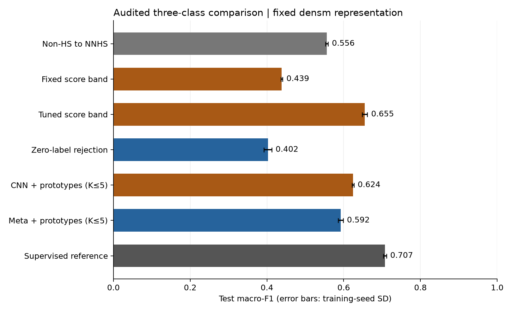
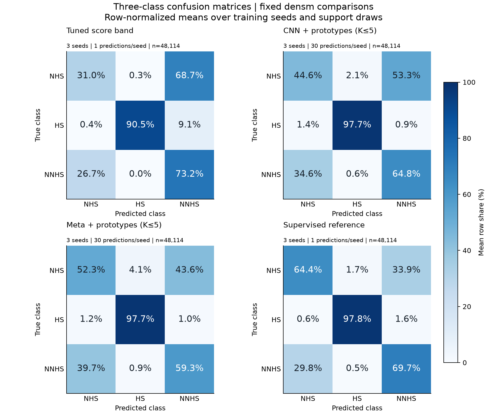
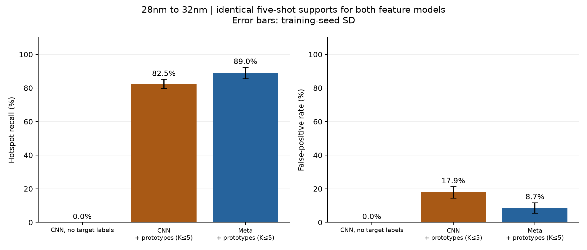

# 光刻热点检测：修正数据协议后的复现实验（v2）

本报告由冻结的方法清单自动生成。旧实验保留在上一级目录，两个版本的测试集不同，分数不应直接相减来衡量算法提升。
这份数据在旧项目中已经被探索过；本次是固定协议后的重新训练与审计评估，不能称为从未接触过的外部测试集。

Manifest SHA-256：`e57454d23e6fb037877fdc376493f21e6a07801be11a50dbc804f115d8779c6b`。完整指标与每次支持集抽样结果见 [metrics.json](metrics.json)，逐样本预测位于 `predictions/`，支持样本编号位于 `support_plans/`。

## 1. 数据边界和评估规则

| 分区 | NHS | HS | NNHS |
|---|---:|---:|---:|
| train | 15,693 | 1,173 | 0 |
| val | 1,743 | 130 | 0 |
| support | 4,199 | 346 | 11,448 |
| tune | 4,206 | 347 | 11,440 |
| test | 12,570 | 1,032 | 34,512 |
| excluded | 14,528 | 1,025 | 50,624 |

划分按邻域和重复关系隔离，并检查统一裁剪、D4 变换后的图像等价关系。官方训练数据关联的测试组件被排除，因而这是受限的去重基准，不代表原始全部测试样本的性能。具体排除规则及数量以 `experiments/v2/audit.json` 为准。

原官方测试来源共 146,277 张，其中排除 66,177 张（45.2%）；保留 80,100 张再分为 SUPPORT、TUNE、TEST。

最终 TEST 有 48,114 张图、5,346 个邻域、4,999 个独立划分组件；全黑图 0 张。角色分布如下：

| 角色 | 样本数 |
|---|---:|
| HS-center | 1,032 |
| NHS-center | 4,314 |
| NHS-neighbour | 8,256 |
| NNHS-neighbour | 34,512 |

TEST 内仍有 384 组原始图像冲突标签，涉及 1,514 张图。对仅以图像为输入的确定性分类器，至少 530 个标签无法同时满足；这不是 Macro-F1 上限，也不意味着所有相关 NNHS 都必错。

- 二分类和元训练只用 TRAIN；全监督三分类用 TRAIN + SUPPORT。
- 双阈值只在 TUNE 上选定；零标签拒识阈值只在 VAL 上选定；最终 TEST 不用于选方法、K 或训练轮次。
- 原型主结果固定 K=5；K=1、10、20 是预先声明的敏感性分析。kNN 的 K=20、100 是额外标签预算实验，不将其包装成少量标签的主结果。
- 每个设计每类最多 K 个支持样本；类别不足时使用实际数量，下面单独列出。CNN 与元学习方法复用完全相同的支持样本编号。
- 各模型独立使用自己的 TUNE 阈值；以下汇总单模型结果，没有混入集成模型。

均值 ± 标准差表示各训练种子结果的均值和标准差（ddof=0）。每个种子的少样本结果先对 30 次支持集抽样取平均；支持集抽样方差另列，不当成 30 个独立训练实验。单种子表示方式对照不宣称稳健性。

## 2. 三分类主结果（固定 densm 表示）

| 方法 | 目标域标签数 | Macro-F1 | HS 召回 | NHS 召回 | NNHS 召回 | 训练种子 |
|---|---:|---|---|---|---|---|
| 基线：非热点全判 NNHS | 0 | 0.556 ± 0.003 | 97.7% | 0.0% | 99.5% | 0, 1, 2 |
| 方案二：固定区间 0.2–0.8 | 0 | 0.439 ± 0.002 | 97.0% | 96.5% | 0.7% | 0, 1, 2 |
| 方案二：双阈值（仅 TUNE 拟合） | 15,993 | 0.655 ± 0.007 | 90.5% | 31.0% | 73.2% | 0, 1, 2 |
| 方案一：零 NNHS 标签的原型距离拒识 | 0 | 0.402 ± 0.010 | 93.9% | 76.5% | 7.2% | 0, 1, 2 |
| 普通 CNN 特征 + 原型 (K≤5) | 75 | 0.624 ± 0.002 | 97.7% | 44.6% | 64.8% | 0, 1, 2 |
| 元学习特征 + 原型 (K≤5) | 75 | 0.592 ± 0.007 | 97.7% | 52.3% | 59.3% | 0, 1, 2 |
| 全监督三分类参考 | 15,993 | 0.707 ± 0.004 | 97.8% | 64.4% | 69.7% | 0, 1, 2 |

标签预算分别指实际提供的支持标签、TUNE 拟合标签或全监督 SUPPORT 标签；这些预算不同的方法并非等监督条件对照。公平的元学习对照是表中的两个同 K 原型方法。

在预先固定的 densm、K=5 比较中，两种方法使用相同的 75 个目标域标签：普通 CNN 特征 + 原型的 Macro-F1 为 0.624，元学习特征 + 原型为 0.592。本次三分类主结果没有显示元学习特征相对普通 CNN 特征的优势。

| 方法 | NHS precision / recall / F1 | HS precision / recall / F1 | NNHS precision / recall / F1 |
|---|---|---|---|
| 基线：非热点全判 NNHS | 0.000 / 0.000 / 0.000 | 0.710 / 0.977 / 0.822 | 0.736 / 0.995 / 0.846 |
| 方案二：固定区间 0.2–0.8 | 0.262 / 0.965 / 0.412 | 0.823 / 0.970 / 0.890 | 0.438 / 0.007 / 0.014 |
| 方案二：双阈值（仅 TUNE 拟合） | 0.299 / 0.310 / 0.301 | 0.953 / 0.905 / 0.928 | 0.743 / 0.732 / 0.736 |
| 方案一：零 NNHS 标签的原型距离拒识 | 0.232 / 0.765 / 0.356 | 0.593 / 0.939 / 0.726 | 0.491 / 0.072 / 0.125 |
| 普通 CNN 特征 + 原型 (K≤5) | 0.330 / 0.446 / 0.370 | 0.686 / 0.977 / 0.806 | 0.768 / 0.648 / 0.696 |
| 元学习特征 + 原型 (K≤5) | 0.326 / 0.523 / 0.399 | 0.550 / 0.977 / 0.702 | 0.789 / 0.593 / 0.674 |
| 全监督三分类参考 | 0.441 / 0.644 / 0.523 | 0.726 / 0.978 / 0.833 | 0.849 / 0.697 / 0.765 |

以下四个面板固定为双阈值、普通 CNN + 5-shot 原型、元学习 + 5-shot 原型、全监督参考，均使用 densm。先对每个训练种子的支持集抽样混淆矩阵取平均，再对训练种子等权平均，最后逐行归一化；每行表示同一真实类别被分到三个预测类别的比例。双阈值和全监督方法每个种子只有一次预测，不虚构支持抽样。

## 3. 同标签预算的支持集实验

| 表示 | 方法 | 实际总标签数 | Macro-F1（训练种子均值 ± SD） | 平均支持抽样 SD |
|---|---|---:|---|---:|
| dens | 普通 CNN 特征 + 原型 (K≤1) | 15 | 0.578（单种子） | 0.047 |
| dens | 普通 CNN 特征 + 原型 (K≤5) | 75 | 0.608（单种子） | 0.032 |
| dens | 普通 CNN 特征 + 原型 (K≤10) | 145 | 0.598（单种子） | 0.027 |
| dens | 普通 CNN 特征 + 原型 (K≤20) | 279 | 0.617（单种子） | 0.019 |
| dens | 普通 CNN 特征 + kNN(15) (K≤20) | 279 | 0.607（单种子） | 0.020 |
| dens | 普通 CNN 特征 + kNN(15) (K≤100) | 1162 | 0.646（单种子） | 0.007 |
| densm | 普通 CNN 特征 + 原型 (K≤1) | 15 | 0.598 ± 0.004 | 0.039 |
| densm | 普通 CNN 特征 + 原型 (K≤5) | 75 | 0.624 ± 0.002 | 0.031 |
| densm | 普通 CNN 特征 + 原型 (K≤10) | 145 | 0.615 ± 0.004 | 0.033 |
| densm | 普通 CNN 特征 + 原型 (K≤20) | 279 | 0.630 ± 0.004 | 0.027 |
| densm | 普通 CNN 特征 + kNN(15) (K≤20) | 279 | 0.627 ± 0.006 | 0.023 |
| densm | 普通 CNN 特征 + kNN(15) (K≤100) | 1162 | 0.661 ± 0.004 | 0.007 |
| squish | 普通 CNN 特征 + 原型 (K≤1) | 15 | 0.494（单种子） | 0.049 |
| squish | 普通 CNN 特征 + 原型 (K≤5) | 75 | 0.517（单种子） | 0.031 |
| squish | 普通 CNN 特征 + 原型 (K≤10) | 145 | 0.515（单种子） | 0.035 |
| squish | 普通 CNN 特征 + 原型 (K≤20) | 279 | 0.524（单种子） | 0.019 |
| squish | 普通 CNN 特征 + kNN(15) (K≤20) | 279 | 0.524（单种子） | 0.019 |
| squish | 普通 CNN 特征 + kNN(15) (K≤100) | 1162 | 0.573（单种子） | 0.012 |
| dens | 元学习特征 + 原型 (K≤1) | 15 | 0.548（单种子） | 0.046 |
| dens | 元学习特征 + 原型 (K≤5) | 75 | 0.574（单种子） | 0.029 |
| dens | 元学习特征 + 原型 (K≤10) | 145 | 0.584（单种子） | 0.020 |
| dens | 元学习特征 + 原型 (K≤20) | 279 | 0.589（单种子） | 0.015 |
| dens | 元学习特征 + kNN(15) (K≤20) | 279 | 0.590（单种子） | 0.021 |
| dens | 元学习特征 + kNN(15) (K≤100) | 1162 | 0.631（单种子） | 0.009 |
| densm | 元学习特征 + 原型 (K≤1) | 15 | 0.566 ± 0.005 | 0.050 |
| densm | 元学习特征 + 原型 (K≤5) | 75 | 0.592 ± 0.007 | 0.023 |
| densm | 元学习特征 + 原型 (K≤10) | 145 | 0.604 ± 0.006 | 0.019 |
| densm | 元学习特征 + 原型 (K≤20) | 279 | 0.611 ± 0.006 | 0.016 |
| densm | 元学习特征 + kNN(15) (K≤20) | 279 | 0.613 ± 0.005 | 0.020 |
| densm | 元学习特征 + kNN(15) (K≤100) | 1162 | 0.652 ± 0.005 | 0.008 |
| squish | 元学习特征 + 原型 (K≤1) | 15 | 0.468（单种子） | 0.051 |
| squish | 元学习特征 + 原型 (K≤5) | 75 | 0.485（单种子） | 0.020 |
| squish | 元学习特征 + 原型 (K≤10) | 145 | 0.492（单种子） | 0.017 |
| squish | 元学习特征 + 原型 (K≤20) | 279 | 0.499（单种子） | 0.017 |
| squish | 元学习特征 + kNN(15) (K≤20) | 279 | 0.495（单种子） | 0.020 |
| squish | 元学习特征 + kNN(15) (K≤100) | 1162 | 0.532（单种子） | 0.008 |

实际每设计每类支持样本数：

| 任务 | 请求 K | 实际计数（设计/类别） |
|---|---:|---|
| cross_iccad1 | 1 | iccad1/NHS: 1; iccad1/HS: 1 |
| cross_iccad1 | 5 | iccad1/NHS: 5; iccad1/HS: 5 |
| cross_iccad1 | 10 | iccad1/NHS: 10; iccad1/HS: 10 |
| cross_iccad1 | 20 | iccad1/NHS: 20; iccad1/HS: 20 |
| three_class | 1 | iccad1/NHS: 1; iccad1/HS: 1; iccad1/NNHS: 1; iccad2/NHS: 1; iccad2/HS: 1; iccad2/NNHS: 1; iccad3/NHS: 1; iccad3/HS: 1; iccad3/NNHS: 1; iccad4/NHS: 1; iccad4/HS: 1; iccad4/NNHS: 1; iccad5/NHS: 1; iccad5/HS: 1; iccad5/NNHS: 1 |
| three_class | 5 | iccad1/NHS: 5; iccad1/HS: 5; iccad1/NNHS: 5; iccad2/NHS: 5; iccad2/HS: 5; iccad2/NNHS: 5; iccad3/NHS: 5; iccad3/HS: 5; iccad3/NNHS: 5; iccad4/NHS: 5; iccad4/HS: 5; iccad4/NNHS: 5; iccad5/NHS: 5; iccad5/HS: 5; iccad5/NNHS: 5 |
| three_class | 10 | iccad1/NHS: 10; iccad1/HS: 10; iccad1/NNHS: 10; iccad2/NHS: 10; iccad2/HS: 10; iccad2/NNHS: 10; iccad3/NHS: 10; iccad3/HS: 10; iccad3/NNHS: 10; iccad4/NHS: 10; iccad4/HS: 10; iccad4/NNHS: 10; iccad5/NHS: 10; iccad5/HS: 5; iccad5/NNHS: 10 |
| three_class | 20 | iccad1/NHS: 20; iccad1/HS: 14; iccad1/NNHS: 20; iccad2/NHS: 20; iccad2/HS: 20; iccad2/NNHS: 20; iccad3/NHS: 20; iccad3/HS: 20; iccad3/NNHS: 20; iccad4/NHS: 20; iccad4/HS: 20; iccad4/NNHS: 20; iccad5/NHS: 20; iccad5/HS: 5; iccad5/NNHS: 20 |
| three_class | 100 | iccad1/NHS: 95; iccad1/HS: 14; iccad1/NNHS: 46; iccad2/NHS: 100; iccad2/HS: 82; iccad2/NNHS: 100; iccad3/NHS: 100; iccad3/HS: 100; iccad3/NNHS: 100; iccad4/NHS: 100; iccad4/HS: 20; iccad4/NNHS: 100; iccad5/NHS: 100; iccad5/HS: 5; iccad5/NNHS: 100 |

同一设计、同一类别内部按 dup_key 去重采样，避免将重复文件计为独立支持样本。不同类别可能有相同图像但冲突标签；这部分不被悄悄删除，完整 trial 的唯一图像数和冲突 key 数均保存在 metrics.json。

| 任务 | 请求 K | 每次标签数 | 每次唯一输入数范围 | 每次冲突输入数范围 |
|---|---:|---:|---|---|
| three_class | 1 | 15 | 15–15 | 0–0 |
| three_class | 5 | 75 | 74–75 | 0–1 |
| three_class | 10 | 145 | 144–145 | 0–1 |
| three_class | 20 | 279 | 277–279 | 0–2 |
| three_class | 100 | 1162 | 1153–1159 | 2–9 |
| cross_iccad1 | 1 | 2 | 2–2 | 0–0 |
| cross_iccad1 | 5 | 10 | 10–10 | 0–0 |
| cross_iccad1 | 10 | 20 | 20–20 | 0–0 |
| cross_iccad1 | 20 | 40 | 40–40 | 0–0 |

## 4. 跨节点二分类迁移

28nm 数据训练后，在 32nm 目标设计上评估。无目标标签的直接迁移与有支持标签的方法单独标明；不会把两者的差值全归因于元学习。这里只测试一个目标节点/设计，不能推断普遍的跨节点优势。

跨节点目标单独由 manifest.cross_target 定义：该设计所有不关联官方训练图的合格中心窗，包含主任务 SUPPORT、TUNE、TEST 分区中的样本。对于跨节点模型，这些目标图及标签都没有参与训练或阈值校准；支持样本来自 manifest.cross_support，即该设计的官方训练数据中保留在 TRAIN 的部分。

| 表示 | 方法 | 目标标签数 | HS 召回 | FA | FPR | ROC-AUC | 目标 HS / NHS |
|---|---|---:|---|---|---|---|---|
| densm | 普通 CNN 直接迁移（目标标签为零） | 0 | 0.0% ± 0.0 pp | 0.0 ± 0.0 | 0.0% ± 0.0 pp | 0.588 ± 0.018 | 65 / 54 |
| densm | 普通 CNN 特征 + 原型 (K≤5) | 10 | 82.5% ± 2.7 pp | 9.7 ± 1.8 | 17.9% ± 3.4 pp | 0.878 ± 0.035 | 65 / 54 |
| densm | 元学习特征 + 原型 (K≤5) | 10 | 89.0% ± 3.3 pp | 4.7 ± 1.7 | 8.7% ± 3.1 pp | 0.962 ± 0.030 | 65 / 54 |

在相同的 10 个目标节点标签下，元学习方法的 HS 召回为 89.0%，普通 CNN 特征方法为 82.5%；FPR 分别为 8.7% 和 17.9%。该观察仅限 iccad1 这一个目标设计的 119 张查询图、58 个组件，不能推广为所有工艺节点上的优势。

这里 HS 召回就是此前报告所谓的 Accuracy，不能与整体分类准确率混用。FA 是错误报为热点的非热点数量；FPR = FA / 非热点数量。

对跨节点主结果，另按 component_id 整组重采样 1,000 次，给出 95% percentile bootstrap 区间。每张查询图的热点预测指示先跨训练种子和支持抽样取平均；区间反映固定模型和支持抽样下的目标样本变动，不包含重新训练的全部不确定性，也不代表跨更多工艺节点的置信区间。

| 方法 | 目标组件数 | HS 召回 95% 区间 | FPR 95% 区间 |
|---|---:|---|---|
| 普通 CNN 直接迁移（目标标签为零） | 58 | 0.0%–0.0% | 0.0%–0.0% |
| 普通 CNN 特征 + 原型 (K≤5) | 58 | 77.3%–87.1% | 13.0%–44.8% |
| 元学习特征 + 原型 (K≤5) | 58 | 84.0%–93.2% | 6.2%–24.1% |

## 5. 二分类中心窗口与表示对照

| 表示 | 阈值 | HS 召回 | FA | FPR | AUC | HS / NHS |
|---|---|---|---|---|---|---|
| dens | 固定 0.5 | 97.9%（单种子） | 5.0（单种子） | 0.1%（单种子） | 0.996（单种子） | 1032 / 4314 |
| densm | 固定 0.5 | 97.7% ± 0.0 pp | 3.0 ± 0.0 | 0.1% ± 0.0 pp | 0.995 ± 0.001 | 1032 / 4314 |
| squish | 固定 0.5 | 97.2%（单种子） | 108.0（单种子） | 2.5%（单种子） | 0.991（单种子） | 1032 / 4314 |

此处不与论文原表的 FA 直接排名：图像格式、数据划分、样本数和训练协议不一致。

| 表示 | 方法（预先固定） | Macro-F1 | 训练种子 |
|---|---|---|---|
| dens | 方案二：双阈值（仅 TUNE 拟合） | 0.662（单种子） | [0] |
| densm | 方案二：双阈值（仅 TUNE 拟合） | 0.655 ± 0.007 | [0, 1, 2] |
| squish | 方案二：双阈值（仅 TUNE 拟合） | 0.563（单种子） | [0] |
| dens | 元学习特征 + 原型 (K≤5) | 0.574（单种子） | [0] |
| densm | 元学习特征 + 原型 (K≤5) | 0.592 ± 0.007 | [0, 1, 2] |
| squish | 元学习特征 + 原型 (K≤5) | 0.485（单种子） | [0] |
| dens | 全监督三分类参考 | 0.775（单种子） | [0] |
| densm | 全监督三分类参考 | 0.707 ± 0.004 | [0, 1, 2] |
| squish | 全监督三分类参考 | 0.652（单种子） | [0] |

dens 全监督参考得到 Macro-F1 0.775，但只运行了 1 个训练种子，不能据此宣称它稳健优于 densm。主比较仍采用预先固定的 densm 多种子结果，不因表示对照的分数而更换主结果。

## 6. 结果解释的边界

- 相同图像存在冲突标签，意味着无法同时正确满足所有冲突标签；不意味着所有相关 NNHS 都必错。
- 全监督三分类是经验参考，不是数学上限；二维投影也不能证明高维特征完全不可分。
- CNN 特征为 256 维、元学习嵌入为 128 维，训练目标和训练预算也不同。相同支持集的结果是两种完整方法的比较，不能将差值严格因果归因于元学习损失一项。
- 概率区间实验使用模型分数，没有声称 softmax 是经过校准的真实物理风险概率。
- 统一裁剪/D4 等价和邻域检查只能排除已建模的重复关系，不能证明不存在任意平移重叠或同源版图片段；当前缺少原始版图坐标。
- 按设计及中心/邻域角色的全部分项指标、混淆矩阵和每次支持抽样指标保存在 metrics.json；不能只根据一个总分忽略 NHS 识别失败。